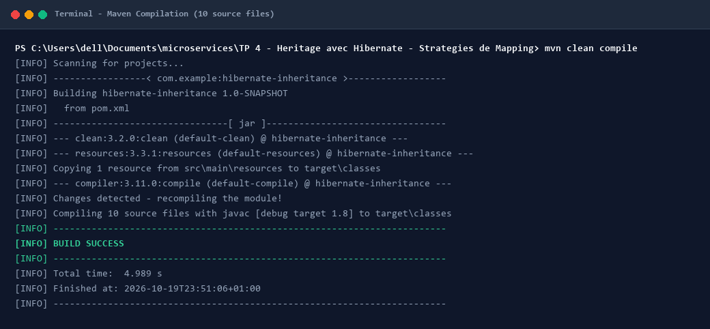
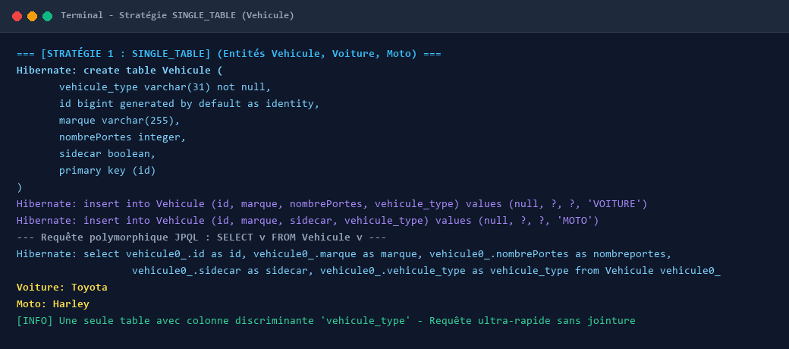
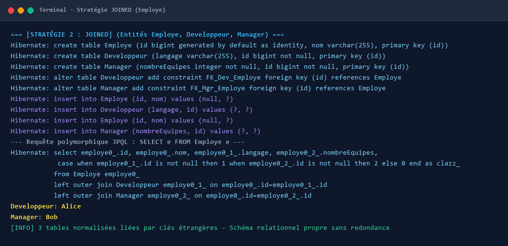
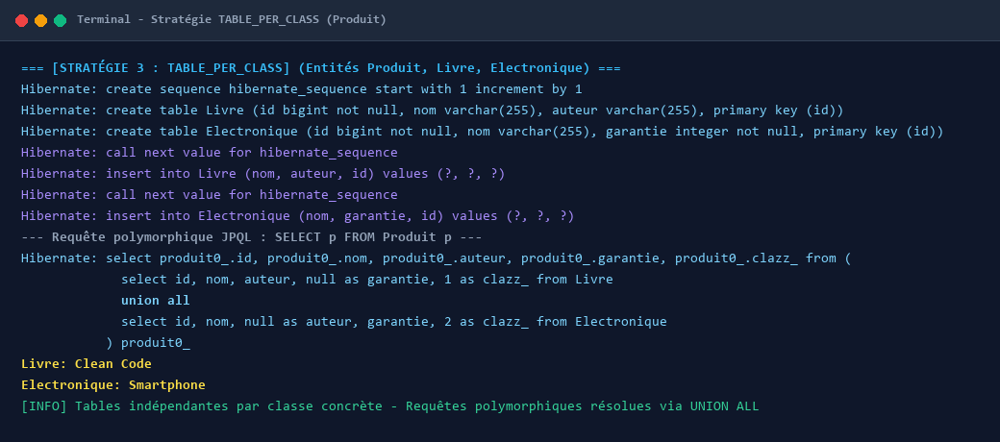
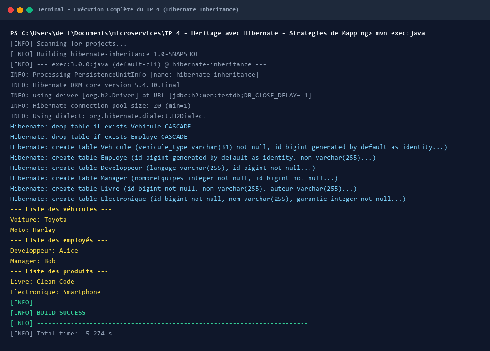

# TP 4 : Héritage avec Hibernate - Stratégies de Mapping

Ce projet met en œuvre et compare les trois principales stratégies de mapping de l'héritage objet-relationnel proposées par **JPA (Java Persistence API)** avec **Hibernate** et une base de données en mémoire **H2**.

---

## 🎯 Objectifs Pédagogiques

1. Comprendre le fonctionnement de l'héritage polymorphique en JPA/Hibernate.
2. Implémenter et tester les trois stratégies d'héritage :
   - **`SINGLE_TABLE`** (Une seule table par hiérarchie avec colonne discriminante)
   - **`JOINED`** (Une table par classe avec jointures et clés étrangères)
   - **`TABLE_PER_CLASS`** (Une table indépendante par classe concrète)
3. Observer et analyser les requêtes SQL (DDL, `INSERT`, `SELECT` polymorphiques) générées par le moteur Hibernate.
4. Évaluer les avantages, inconvénients et cas d'usage optimaux de chaque stratégie.

---

## 📁 Structure du Projet

```text
TP 4 - Heritage avec Hibernate - Strategies de Mapping/
├── pom.xml                                      # Configuration Maven, Hibernate 5.4.30 & H2
├── screenshots/                                 # Captures d'écran de l'exécution terminal
│   ├── 01_maven_build_compile.png
│   ├── 02_single_table_strategy.png
│   ├── 03_joined_strategy.png
│   ├── 04_table_per_class_strategy.png
│   └── 05_full_execution_overview.png
├── src/
│   ├── main/
│   │   ├── java/
│   │   │   └── com/
│   │   │       └── example/
│   │   │           ├── App.java                 # Classe principale de test CRUD & JPQL
│   │   │           └── model/
│   │   │               ├── singletable/         # Stratégie SINGLE_TABLE
│   │   │               │   ├── Vehicule.java    # Classe de base abstraite (@DiscriminatorColumn)
│   │   │               │   ├── Voiture.java     # Sous-classe (@DiscriminatorValue("VOITURE"))
│   │   │               │   └── Moto.java        # Sous-classe (@DiscriminatorValue("MOTO"))
│   │   │               ├── joined/              # Stratégie JOINED
│   │   │               │   ├── Employe.java     # Classe de base abstraite
│   │   │               │   ├── Developpeur.java # Sous-classe avec clé étrangère
│   │   │               │   └── Manager.java     # Sous-classe avec clé étrangère
│   │   │               └── tableperclass/       # Stratégie TABLE_PER_CLASS
│   │   │                   ├── Produit.java     # Classe de base abstraite
│   │   │                   ├── Livre.java       # Table concrète indépendante
│   │   │                   └── Electronique.java# Table concrète indépendante
│   │   └── resources/
│   │       └── META-INF/
│   │           └── persistence.xml              # Unité de persistance JPA & config H2
└── README.md
```

---

## ⚙️ Compilation et Validation du Projet

Le projet compile l'ensemble des 10 classes Java sous Java 8+ avec Maven.

### 📸 Capture Terminal : Compilation Maven



*Description de l'exécution : Téléchargement des dépendances JPA/Hibernate/H2 et compilation avec succès (`BUILD SUCCESS`).*

---

## 🔬 Analyse Détaillée des Stratégies de Mapping

---

### 1️⃣ Stratégie `SINGLE_TABLE` (Une seule table pour toute la hiérarchie)

Dans cette stratégie, toute la hiérarchie de classes (`Vehicule`, `Voiture`, `Moto`) est persistée dans une unique table relationnelle nommée `Vehicule`.
- Une colonne spéciale appelée **discriminant** (`vehicule_type`) permet de déterminer le type réel de chaque ligne (`VOITURE` ou `MOTO`).
- Les colonnes spécifiques aux sous-classes (`nombrePortes` pour Voiture, `sidecar` pour Moto) coexistent dans la même table et acceptent des valeurs `NULL`.

#### 📸 Capture Terminal : Exécution Stratégie SINGLE_TABLE



#### 📝 Analyse du comportement SQL :
- **DDL Généré :** Création d'une table unique `Vehicule` avec la colonne `vehicule_type varchar(31)`.
- **Insertion :** `INSERT INTO Vehicule (id, marque, nombrePortes, vehicule_type) VALUES (null, ?, ?, 'VOITURE')`.
- **Requête Polymorphique :** La requête JPQL `SELECT v FROM Vehicule v` interroge directement la table `Vehicule` sans aucune jointure, offrant les meilleures performances en lecture.

---

### 2️⃣ Stratégie `JOINED` (Une table par classe avec jointure)

Dans cette stratégie, chaque classe de la hiérarchie possède sa propre table dans la base de données :
- `Employe` (table mère contenant `id`, `nom`)
- `Developpeur` (table fille contenant `id`, `langage`)
- `Manager` (table fille contenant `id`, `nombreEquipes`)
- Les tables des sous-classes sont reliées à la table mère par des contraintes de clés étrangères (`FOREIGN KEY`).

#### 📸 Capture Terminal : Exécution Stratégie JOINED



#### 📝 Analyse du comportement SQL :
- **DDL Généré :** Création de 3 tables distinctes et ajout des contraintes de clés étrangères `FK_Dev_Employe` et `FK_Mgr_Employe`.
- **Insertion :** Deux requêtes `INSERT` successives sont exécutées pour chaque enregistrement : une dans la table mère `Employe`, puis une dans la table spécifique (`Developpeur` ou `Manager`).
- **Requête Polymorphique :** La requête JPQL `SELECT e FROM Employe e` génère automatiquement des requêtes `LEFT OUTER JOIN` pour reconstituer les objets polymorphiques avec une clause `CASE WHEN ... THEN ... END AS clazz_`.

---

### 3️⃣ Stratégie `TABLE_PER_CLASS` (Une table par classe concrète)

Dans cette stratégie, seules les sous-classes concrètes ont une table dédiée dans la base de données :
- `Livre` (contient `id`, `nom`, `auteur`)
- `Electronique` (contient `id`, `nom`, `garantie`)
- La classe mère abstraite `Produit` n'a pas de table propre ; ses attributs (`id`, `nom`) sont dupliqués dans chaque table fille.
- Une séquence globale `hibernate_sequence` est utilisée pour garantir l'unicité des identifiants à travers toutes les tables.

#### 📸 Capture Terminal : Exécution Stratégie TABLE_PER_CLASS



#### 📝 Analyse du comportement SQL :
- **DDL Généré :** Création d'une séquence `hibernate_sequence` et de deux tables indépendantes `Livre` et `Electronique`.
- **Insertion :** Hibernate appelle `call next value for hibernate_sequence` pour obtenir un ID unique avant d'insérer dans la table concrète.
- **Requête Polymorphique :** La requête JPQL `SELECT p FROM Produit p` génère une sous-requête avec opérateur `UNION ALL` pour fusionner les enregistrements des tables filles.

---

## 🚀 Vue d'Ensemble de l'Exécution Complète

L'exécution globale de la classe `com.example.App` valide les trois stratégies au sein d'une même transaction JPA.

### 📸 Capture Terminal : Exécution Globale



*Résultat de l'exécution affiché dans la console :*
```text
--- Liste des véhicules ---
Voiture: Toyota
Moto: Harley

--- Liste des employés ---
Developpeur: Alice
Manager: Bob

--- Liste des produits ---
Livre: Clean Code
Electronique: Smartphone
```

---

## 📊 Tableau Comparatif des Stratégies de Mapping

| Caractéristique | SINGLE_TABLE | JOINED | TABLE_PER_CLASS |
| :--- | :--- | :--- | :--- |
| **Nombre de tables** | 1 table unique | $N$ tables (1 par classe) | $N$ tables (1 par classe concrète) |
| **Normalisation BD** | Faible (colonnes `NULL`) | Élevée (3NF) | Moyenne (colonnes dupliquées) |
| **Colonnes nullables** | Obligatoires pour sous-classes | Non (contraintes `NOT NULL` possibles) | Non (contraintes `NOT NULL` possibles) |
| **Jointures SQL** | Aucune jointure | `LEFT OUTER JOIN` | `UNION ALL` |
| **Performance Lecture** | ⚡ Maximale | ⚠️ Ralentie si hiérarchie profonde | ⚠️ Coûteuse en polymorphisme |
| **Performance Écriture** | ⚡ 1 seul `INSERT` | ⚠️ Multiples `INSERT` par entité | ⚡ 1 seul `INSERT` |
| **Idéal pour** | Hiérarchies simples et stables | Modèles riches et normalisés | Hiérarchies indépendantes |

---

## 🛠️ Instructions d'Exécution Locale

### Prérequis
- Java JDK 8 ou supérieur
- Apache Maven 3.6+

### Commandes
```bash
# 1. Cloner le dépôt
git clone https://github.com/OussamaFETOUAKI/TP-4-Heritage-avec-Hibernate-Strategies-de-Mapping.git

# 2. Accéder au dossier
cd "TP-4-Heritage-avec-Hibernate-Strategies-de-Mapping"

# 3. Compiler le projet
mvn clean compile

# 4. Lancer l'application
mvn exec:java
```

---

*Développé dans le cadre des travaux pratiques de JEE / JPA / Hibernate.*
